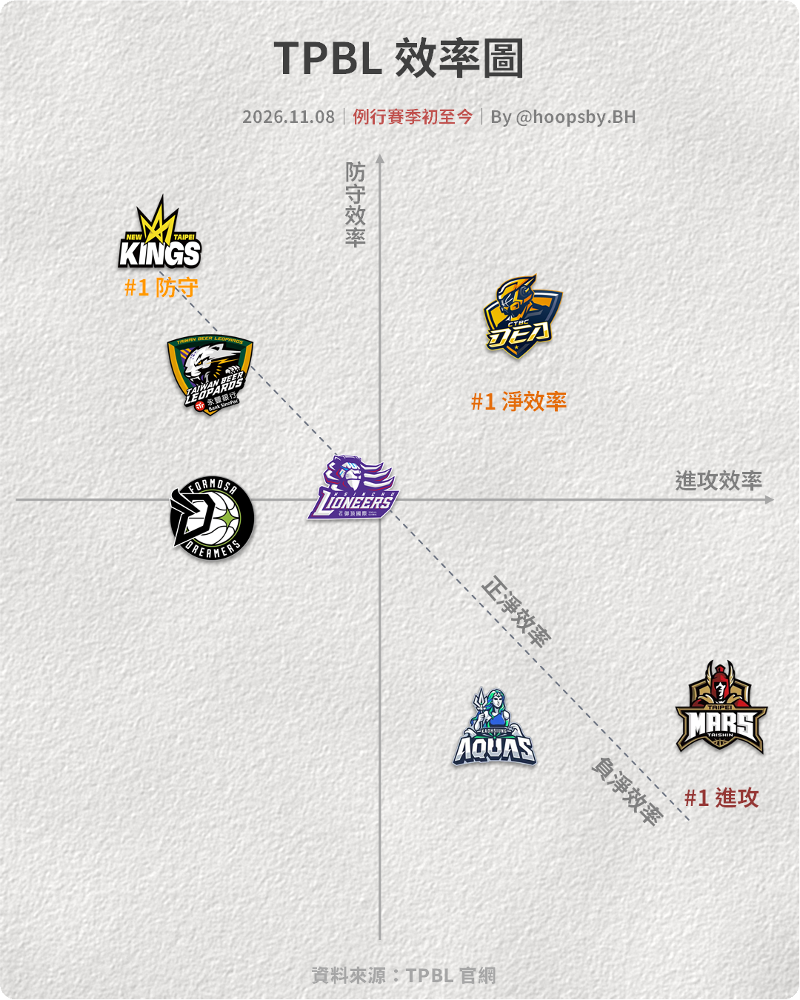
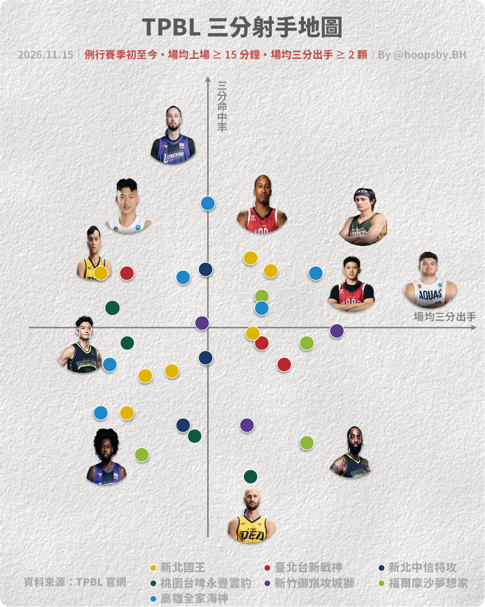

# 嗨，我是莊秉翰 👋

用數據看籃球，也用數據解決問題。大學修了網頁架設、機器學習、資料探索與視覺化等課程，課外用籃球數據當題材，搭配 AI 工具把想法做成實際可用的工具。

- 📊 IG：[@hoopsby.bh](https://www.instagram.com/hoopsby.bh/)，每週更新台灣職籃數據圖卡
- 🛠 工具：Python（pandas、requests、BeautifulSoup）、SQL（DuckDB，學習中）、Excel／Power Query、R、Power BI、Tableau、HTML／JavaScript

---

## 1. TPBL 籃球數據自動化分析：每週持續更新

`Python` `API` `SQL` `Excel` `Google Colab`

  
  

**短影片（IG Reels）**

https://github.com/user-attachments/assets/e07d643a-dc6b-44b1-a182-0bd2d22ca292

https://github.com/user-attachments/assets/31478a87-661e-4d97-8c66-cf0c22618731

**做了什麼**
- **資料取得**：TPBL 官網背後有公開的 JSON API，改用 API 取得賽程與每場比賽的球隊、球員數據，比解析網頁穩定。
- **自動化**：在 Google Colab 用 Python（requests、pandas）寫成固定流程。已抓過的比賽會快取，只抓新比賽；結果輸出成 CSV 存到 Google 雲端硬碟，Excel 以 Power Query 連結，一鍵更新。
- **資料處理**：由每場數據估算回合數，計算進攻／防守／淨效率、節奏、四因子，以及球員的真實命中率、使用率等進階指標。
- **資料庫與 SQL**：資料重新設計成 5 張表（比賽、球隊、球員、球隊逐場、球員逐場），補進過去兩季；只存原始數字，指標用 SQL（DuckDB）計算。加入自動檢查（球員得分加總需等於球隊得分），避免錯誤數據進到圖表。
- **視覺化**：Excel 四象限圖（下拉選單切換指標）、球員散佈圖，再製成圖卡與短影片發佈在 IG。

---

## 2. ShotChart：籃球影片情蒐工具

`HTML` `JavaScript` `資料標記` `Netlify`

**做了什麼**
- **用途**：協助球隊情蒐對手，邊看比賽影片邊在球場圖上標記每個回合。
- **資料蒐集**：每筆紀錄連結影片時間點，並標記出手位置、結果、打法、第一下運球方向、戰術名稱、對方防守型態等標籤。
- **分析**：自動計算命中率、每回合得分（PPP）、真實命中率，依區域、打法、戰術彙整，並自動產生重點傾向（例如「第一下運球偏右手」）。可跨場次比較同一戰術，也能匯出 CSV。
- **分享**：產出手機版觀看頁並部署到 Netlify，教練與選手從 LINE 點連結，就能依戰術或球員播放對應片段；並依教練團的回饋持續改版。

---

## 3. UBA 大專籃球勝負預測（學術海報）

`Python` `爬蟲` `scikit-learn` `決策樹` `隨機森林`

**做了什麼**
- **資料取得**：用 Python（requests、BeautifulSoup）爬取 UBA 公開男一級 112–114 學年度共 455 場比賽、910 筆隊伍攻守紀錄。失敗會自動重試並列出清單，用比分核對球隊對應，再人工補齊缺漏場次。
- **特徵設計**：把每場兩隊的數據轉成差值（主隊 − 客隊、客隊 − 主隊），並以比賽為單位切分訓練／測試集（75% / 25%），同一場不拆開，避免資料洩漏。
- **建模與驗證**：用決策樹與隨機森林預測勝負，測試集準確率分別為 83.77% 與 89.47%，並以 5 折交叉驗證確認穩定性（平均 85.16% / 89.67%）。
- **發現**：兩個模型的特徵重要性都以助攻、防守籃板居前，代表這兩項是預測大專比賽勝負的穩定指標；決策樹的規則也能轉成教練可用的判斷依據。
- 本研究與指導老師陳建霖、謝宗諭共同發表。

---

## 關於 AI 協作

這些作品的程式多半是和 AI（Claude）協作撰寫。我負責定義需求、設計流程、實際執行、驗證數字，以及在出錯時找出問題並修正。我認為把 AI 用好、並且確認它的產出是對的，本身就是一項重要的能力。
